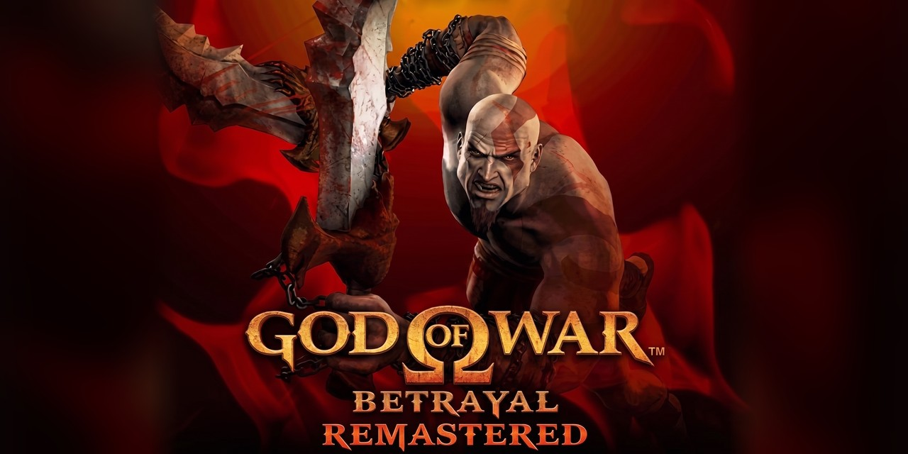

# God of War: Betrayal Remastered



A native Windows port of *God of War: Betrayal*, the 2007 side-scrolling
*God of War* made for J2ME (mobile Java) phones. It is rebuilt from the
original game's own decompiled code, not emulated, and adds widescreen, high
frame rates and modern controls.

**Status: complete.** The game is finished, released as the stable 1.0.0, and
has been played from start to finish. The project is no longer in active
development, though new features may still arrive as occasional updates, and
the launcher will pick those up automatically.

| Original | Launcher | You supply |
|---|---|---|
| Sony Ericsson K800i build, 240x320, MIDlet 1.4.20 | `GodOfWar.exe` | `God-of-War-Betrayal_K800i_v1420.jar` (any copy of that build) |

## Download and play

**The game is not included.** It belongs to its rights holders, so you need
your own copy of the K800i `.jar`. Other versions of the game are not
supported, and the launcher tells you if you pick one.

1. Download the zip from the
   [Releases page](https://github.com/samioan/gow-betrayal-remastered/releases)
   and unzip it anywhere.
2. Run **GodOfWar.exe** and click **Choose file...** to pick your `.jar`. The
   launcher unpacks it for you.
3. Choose **Fullscreen** or **Windowed** and press **Play**.

There is no installer, and no Visual C++ redistributable is needed. The
launcher checks GitHub for newer builds on start-up, offers an **Update**
button when there is one, and keeps your saves.

### What the port adds

| | |
|---|---|
| Widescreen | Original, Auto, 4:3, 16:10, 16:9, 21:9 |
| Frame rate | Original, 60, 90, 120, 144, 165, 240, Unlimited, with interpolated frames |
| Game speed | Stays at the original 25 logic steps a second |
| Fullscreen | Borderless by default; F11 or Alt+Enter toggles it |
| Controls | Keyboard and XInput gamepad |

Widescreen shows more of the level and never stretches sprites or the HUD.
The options are in **Main menu > Options** and in the pause menu. The zip's
`README.txt` covers the controls.

### Troubleshooting

The music and sound effects are MIDI, played through the Windows synthesizer,
so they sound different from an emulator or the phone; that is expected.
Sound problems are logged to `%LOCALAPPDATA%\gow-betrayal-port\audio.log`.

Game files stay in `data\` next to the launcher. Saves and display settings
live in `%LOCALAPPDATA%\gow-betrayal-port\`. To uninstall, delete the game's
folder, and delete that one too if you want to remove your saves.

## How it was made

The game is plain JVM bytecode with minifier-style obfuscation, so
[Vineflower](https://github.com/Vineflower/vineflower) recovers close-to-original
Java directly. From there the code was read through and renamed, and the
game's custom binary formats (resource banks, sprite atlases, animation sets,
bit-packed levels) were parsed and verified byte for byte.

The port is translated mechanically: `tools/java2cpp.py` turns the renamed
Java into C++, and a hand-written engine and platform layer sit underneath.
Patches for widescreen, settings and interpolation are applied during
translation (`tools/gow_port_patches.py`), so the renamed Java stays a plain
decompile. It is C++17 on raw Win32 and GDI, with no SDL, Direct3D or OpenGL.

The project started on the generic v1.4.8 jar and moved to the Sony Ericsson
K800i build, which has larger 22 px tiles, a parallax background in every
level, better art and all eleven MIDI tracks in use.

## Repository layout

| Path | Contents |
|---|---|
| `betrayal/decompiled/` | Raw Vineflower output |
| `betrayal/src/` | Renamed, compile-checked Java (generated from `names.map`) |
| `betrayal/docs/` | Roadmaps, class map, asset formats and `names.map` |
| `betrayal/port/` | The C++ port, launcher and packaging scripts |
| `tools/` | Extraction, decompilation, renaming, parsing and translation scripts |
| `roms/`, `betrayal/extracted/` | Your original jar and its contents (gitignored, never commit) |

### Documentation

| Topic | File |
|---|---|
| Reverse-engineering record | [ROADMAP](betrayal/docs/ROADMAP.md) |
| Port development log | [PORT_ROADMAP](betrayal/docs/PORT_ROADMAP.md) |
| Classes and members | [CLASS_MAP](betrayal/docs/CLASS_MAP.md) |
| Binary formats | [ASSET_FORMATS](betrayal/docs/ASSET_FORMATS.md) |
| Store page copy | [ITCH_PAGE](betrayal/docs/ITCH_PAGE.md) |

The scripts are described in [tools/README.md](tools/README.md).

## Building from source

You need Windows, Visual Studio or the VS Build Tools with the C++ workload,
CMake and Ninja. Regenerating sources also needs Python 3.10+ (`pip install
javalang`) and a Java 17+ JDK (see [tools/README.md](tools/README.md)).

```
python tools\extract_jar.py          & rem unpack your jar from roms\
python tools\decompile.py
python tools\rename_gow.py           & rem renamed Java -> betrayal\src + compile check
python tools\java2cpp.py             & rem -> betrayal\port\src\gen
betrayal\port\build.bat              & rem builds betrayal\port\build\gow_port.exe
```

To build the same package that gets released, run
`betrayal\port\build_dist.bat <version>` and then
`betrayal\port\check_dist.ps1`, which confirms that no game data or VC runtime
slipped in. The output is in `betrayal\port\dist\`.

## Releases and self-update

Pushing a tag such as `gow-v1.2.3` runs the release workflow
(`.github/workflows/release.yml`), which builds, checks and publishes the zip.
The tag sets the version, and any `0.x` or suffixed version is marked as a
pre-release.

The launcher finds updates by listing this repository's releases and taking
the newest `gow-v` tag that has a `.zip` attached. Keeping updates working for
people who already have the game means:

- **Do not rename or move the repository.** The owner and repository name
  (`samioan/gow-betrayal-remastered`) are compiled into every released launcher.
- Keep the `gow-v` tag prefix, and keep a `.zip` on each release.

## Legal

This project is not affiliated with, endorsed by, or supported by Sony
Interactive Entertainment, Santa Monica Studio, Glu Mobile, Metaflow, or the
game's original developers and publishers. *God of War* is a trademark of Sony
Interactive Entertainment LLC. See [NOTICE.md](NOTICE.md) for attribution and
third-party licences.
